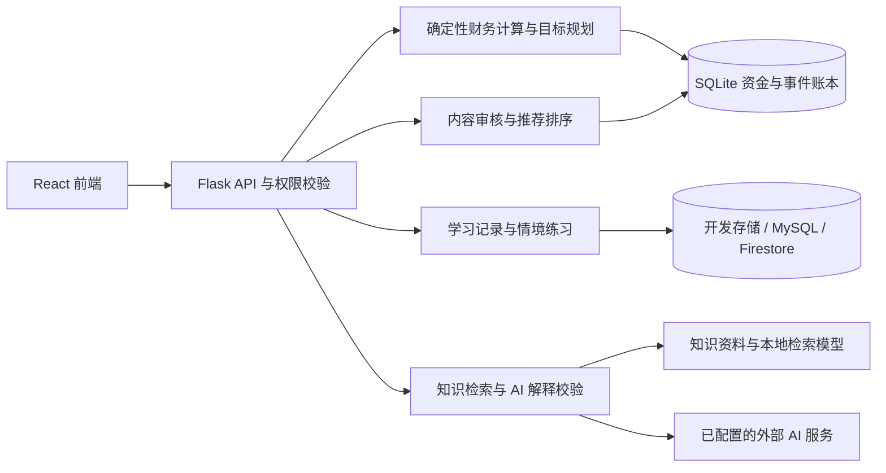

<div align="center">

# 青盈 · YouthGain

**看懂花费，安排生活。**

融合行为经济学与情境化智能辅导及推荐的大学生财商实践平台。<br />
从一笔真实消费开始，连接消费感知、资金安排、知识学习与自主回顾。

[](LICENSE)
[](package.json)
[](backend/requirements.txt)
[](#project-status)

[快速开始](#quick-start) · [功能概览](#features) · [系统设计](#architecture) · [文档](#documentation) · [参与贡献](#contributing)

</div>

## 为什么做青盈

记下“花了多少钱”只是开始。青盈希望把消费记录进一步连接到三个问题：**钱去了哪里、接下来要留多少钱、这次选择是否符合自己的需要。**

项目将记账、目标规划、情境练习与 AI 教练放在同一条使用路径里，让金融知识可以回到日常生活中实践。应用不会代用户支付、自动转账或执行投资交易。

```text
记录或导入 → 看懂累计花费 → 确认自己的感受 → 辅导与知识推荐 → 自主行动与回顾
```

<a id="features"></a>
## 功能概览

| 模块 | 可以做什么 |
| --- | --- |
| 今天 | 查看分类累计消费并展开成钱币；确认感受后带入教练或复盘，回看上次行动；保留本月收支、开支安排、情境练习和音频推荐 |
| 收支账本 | 手动记账、语音转文字录入、CSV / 微信 XLSX 导入、退款关联、分类图表与花销钱币展示 |
| 资金安排 | 区分实际收入、上月结转和储蓄锁定，管理目标金额、截止日与未来开支 |
| 学习与复盘 | 完成多步情境练习，比较消费方案，记录选择理由并回看实际体验 |
| AI 教练 | 围绕具体问题交流；根据资料缺口选择追问、补检或解释已有计算，主动授权后结合个人资料与消费汇总，展示回答依据 |
| 知识与音频 | 阅读金融教育资料；自动筛选可信来源的增量更新，按来源策略发布或复核；从已审核目录推荐具体音频单集，支持收藏和反馈 |
| 管理与研究 | 管理用户、知识与音频内容；研究参与单独授权，学校端按权限查看群体统计 |

### 情境化实践试用版

首页使用后端的完整月度分类汇总，区分支出、退款和净支出；没有记录不等于没有花费。用户自行判断是否符合预期，再选择带入教练或复盘，进入后仍需确认发送或保存。已有推荐服务保持独立，不会根据首页临时选择实时重排。

当前尚无真实用户试用结论。自动化与模拟使用用于验证流程和数据边界，不代表已经证明财商提升或推荐有效。实施步骤、验收结果与试用任务见[情境化财商实践改进计划](docs/青盈情境化财商实践改进计划.md)。设置 `REACT_APP_SPENDING_JOURNEY=false` 后重新启动或构建可关闭本轮入口增强，已保存记录仍可在原页面访问。

### 财务计算与 AI 解释分开

```text
本月可用剩余 = 上月结转结余 + 本月实际收入 − 本月净支出 − 本月净储蓄划拨
```

- **实际到账才计入收入**：预计兼职收入或生活费不直接当成可用资金。
- **储蓄独立记账**：内部划拨不算收入或消费；已锁定资金不会重复扣减。
- **缺失数据明确提示**：没有确认结转、漏记账单或资料过期时，结果可能不完整。
- **试算有各自口径**：收支结余、账户估算余额和本月可用剩余不能混用。详见[资金模块定义](docs/财务推荐v2模块定义.md)。

### 自动知识库与自适应辅导

知识管理页显示实际文章数、全文片段数、持久索引状态及可配置配额（默认 1,000 篇 / 20,000 片段，非实际库存或性能承诺）。自动筛选结合来源规则、模型分类与原文摘录校验；现有来源保留人工发布，确认使用范围后可逐来源开启合格基础内容自动发布，异常仍需复核。教练的动作选择采用模型与程序约束，并保留规则回退；目前未训练新策略模型，也未证明教育效果。实际库存、验证结果、限制及开关回退见[实施记录](docs/自动知识库与自适应辅导实施记录.md)。

<a id="quick-start"></a>
## 快速开始

### 环境要求

统一启动器面向 **Windows**，需要 **Git、Node.js 18+、Python 3.10+**。首次安装依赖需要联网。其他操作系统未通过此启动器验证。

### 1. 获取源码

```powershell
git clone https://github.com/fairy-song/YouthGain.git
cd YouthGain
Copy-Item .env.example .env.local
```

已有工作区请保留原配置，**不要覆盖 `.env.local`**。

### 2. 配置本机演示模式

在 `.env.local` 中设置：

```dotenv
APP_ENV=development
DEV_MODE=true
DB_TYPE=memory
RESEARCH_LIVE_ENABLED=false
PODCAST_RANKER_MODE=baseline
```

> [!IMPORTANT]
> `DEV_MODE=true` 会使用模拟身份登录，不验证真实密码，仅用于可信的本机开发环境。不要填入常用真实密码，不要将开发服务暴露到公网。`DB_TYPE=memory` 的开发数据会持久化到本地文件，并非重启即清空。

不填写 Firebase 前端配置与 AI 密钥也可先体验记账和基础学习。语音识别、完整模型回答等能力需要另外配置服务。

### 3. 启动

```powershell
.\快速启动.cmd
```

也可以双击根目录的 `快速启动.cmd`。启动器会检查环境、准备虚拟环境与依赖，然后启动前后端并检查就绪状态。

| 服务 | 本地地址 |
| --- | --- |
| 应用 | [http://127.0.0.1:3000/#/](http://127.0.0.1:3000/#/) |
| 后端健康检查 | [http://127.0.0.1:5001/api/health](http://127.0.0.1:5001/api/health) |

本地模拟登录可使用自己的测试邮箱与任意非空密码。管理后台默认示例邮箱为 `admin@youthgain.com`，实际权限由后端 `ADMIN_EMAILS` 判定。

<details>
<summary>环境检查、重启与常见问题</summary>

```powershell
.\快速启动.cmd -CheckOnly   # 只检查环境
.\快速启动.cmd -Restart     # 重启本项目服务
.\快速启动.cmd -NoBrowser   # 启动但不打开浏览器
```

- **页面无法连接**：先检查健康接口与 `logs/` 中的前后端日志，确认端口 3000 / 5001 未被其他程序占用。
- **修改配置没有生效**：重启后端；修改 `REACT_APP_*` 后还需重新启动或构建前端。
- **语音不可用**：检查讯飞配置、浏览器权限和麦克风，也可使用文本录入。
- **教练或推荐降级**：检查对应密钥、模型文件与来源目录；降级结果不代表完整模型分析成功。
- **更新前备份**：保留开发数据、SQLite 文件和本地配置。关闭启动窗口不等于停止后台服务。

启动后可用独立演示邮箱 `demo@youthgain.local` 登录，再运行根目录的 `刷新演示数据.cmd` 补充带“检验样例”标记的数据；脚本会检查账户内容并备份，遇到未标记记录时拒绝覆盖。详见[演示账户说明](docs/播客兜底与演示账户完成说明.md)。

详见[完整使用说明](docs/使用说明.md)。

</details>

## 配置说明

完整变量见 [.env.example](.env.example)。只为要启用的能力填写配置，密钥不应出现在前端源码或 Git 提交中。

| 能力 | 主要配置 | 说明 |
| --- | --- | --- |
| 真实认证 | `FIREBASE_ADMIN_SDK_PATH`、`REACT_APP_FIREBASE_*` | 配置 Firebase，关闭模拟登录 |
| AI 教练 | `ZHIPUAI_API_KEY` | 模型与检索设置见 AI 实现文档 |
| 语音识别 | `XFYUN_APP_ID`、`XFYUN_API_KEY`、`XFYUN_API_SECRET` | 需要讯飞服务与浏览器麦克风权限 |
| 业务存储 | `DB_TYPE`、`MYSQL_*` 或 Firestore 配置 | 开发文件存储、MySQL 或 Firestore |
| 资金与推荐账本 | `PODCAST_DB_PATH` | 推荐、快照、储蓄目标与内部资金账目使用持久化 SQLite |
| 推荐排序 | `PODCAST_RANKER_MODE`、`PODCAST_HSTU_MODEL_PATH` | 无有效权重时使用规则回退；演示权重不作为真实效果证据 |
| RSS 采集 | `PODCAST_RSS_ALLOWED_HOSTS` | 仅采集经过核准的来源 |
| 管理权限 | `ADMIN_EMAILS` | 按登录邮箱核验角色 |
| 学校研究 | `RESEARCH_LIVE_ENABLED`、`RESEARCH_DB_PATH` | 默认不启用真实研究；需单独配置、授权与验收 |

<a id="architecture"></a>
## 系统设计



- **前端**：React 18、React Router、React Bootstrap，部分视觉交互使用 Three.js。
- **教练检索**：BM25 与语义向量召回，经 RRF 融合和 Cross-Encoder 重排；模型回答检查数值绑定、来源编号与引用片段，校验失败时重试或返回可核对的回退内容。
- **内容推荐**：审核目录、财务快照、学习主题与历史反馈共同参与排序；支持规则排序、本地 HSTU 推理及影子比较模式。
- **数据边界**：财务事实由程序计算，模型负责解释；个人记录引用与研究参与分别授权。

模型准备、训练与验证步骤见 [AI 教练与 HSTU 实现说明](docs/AI教练与HSTU实现说明.md)。合成训练指标不能证明真实校园推荐效果或金融素养提升。

### 仓库结构

```text
YouthGain/
├── src/                  # React 页面、组件、认证与 API 客户端
├── public/               # 静态资源与账单导入模板
├── backend/
│   ├── app/routes/       # API 路由与权限入口
│   ├── app/services/     # 财务、学习、教练、推荐与研究服务
│   ├── app/sql/          # SQLite 表结构与迁移
│   ├── content/          # 初始知识资料与导入工具
│   └── tests/            # 后端测试
├── scripts/              # 启动、环境检查与维护脚本
├── docs/                 # 项目文档及已生成的前端站点文件
└── 快速启动.cmd           # Windows 统一启动入口
```

## 开发与测试

在项目根目录执行，先按快速开始准备依赖。后端测试另需安装 `pytest`。

```powershell
# 后端
.\.venv\Scripts\python.exe -m pip install pytest
.\.venv\Scripts\python.exe -m pytest backend/tests -q

# 前端
npm test -- --watchAll=false --runInBand
npm run build
```

测试应使用合成账户与账单，不连接个人真实财务数据。测试数量会随分支变化，以本次运行结果为准；本 README 不使用固定测试数量或未经配置的 CI 徽章作为质量承诺。

## 部署说明

公开部署与本机演示使用不同的安全配置：关闭 `DEV_MODE`，配置真实认证、持久化数据库、随机 `SECRET_KEY`、HTTPS 与允许的跨域来源；不要把开发启动器直接作为公网生产服务。

GitHub Pages 只能托管静态前端，完整功能需要单独部署后端，并在构建时配置 `REACT_APP_API_URL`。存在静态站点文件不代表在线 API 已经可用。详细步骤见[使用说明](docs/使用说明.md)。

<a id="project-status"></a>
## 项目状态与演进

项目处于持续开发阶段，适合本地体验、课程研究与功能验证。知识内容审核、真实服务联调和推荐效果评价仍需持续完善。

**本次增强**：已纳入花销钱币可视化、知识来源增量更新、播客候选兜底及全站交互修复。动态知识来源在新环境默认停用，启用后先进入审核台账，审核通过才发布；本地已采集文章和用户数据不随源码上传。

本地回退脚本依赖 `tmp/` 中对应的修改前快照，这些快照不随仓库分发；新克隆环境请通过 Git 历史管理代码回退，并单独备份数据库。

后续方向见[长期迭代思路](docs/青盈长期迭代里程思路.md)。

<a id="documentation"></a>
## 文档导航

| 文档 | 适合什么时候阅读 |
| --- | --- |
| [完整使用说明](docs/使用说明.md) | 配置、启动、账单导入与排查问题 |
| [功能与技术](docs/目前版本实现的功能及其对应的技术.md) | 了解功能范围与对应实现 |
| [资金与推荐模块定义](docs/财务推荐v2模块定义.md) | 核对资金口径、不可变快照与服务边界 |
| [AI 教练与 HSTU](docs/AI教练与HSTU实现说明.md) | 准备模型、训练推理与验证机制 |
| [每日推荐接口](docs/每日推荐接口与实施说明.md) | 理解推荐流程、反馈与兼容规则 |
| [播客采集与审核](docs/播客三阶段升级与运行说明.md) | 配置内容发现、增量采集与人工审核 |
| [OpenAPI schema](docs/api/finance-podcasts.openapi.json) | 对接资金、推荐、反馈与推理接口 |
| [手动收支接口](docs/api/手动收支接口.md) | 对接账单创建与收支记录 |
| [花销钱币可视化](docs/花销钱币可视化第一版.md) | 查看金额拆分、展示边界与功能开关 |
| [知识库持续更新](docs/知识库持续更新实施方案.md) | 配置可信来源、检查内容变化与审核发布 |
| [自动知识库与自适应辅导](docs/自动知识库与自适应辅导实施记录.md) | 实际容量、自动筛选、动作选择、验收与回退 |
| [AI 论文调研与实施方案](docs/青盈AI论文调研与自动知识库方案-20261107.md) | 研究依据、可实现的创新方向与评估边界 |
| [全站交互检查](docs/全站交互检查与修复记录.md) | 查看问题复现、修复及验证范围 |

<a id="contributing"></a>
## 参与贡献

欢迎提交 [Issue](https://github.com/fairy-song/YouthGain/issues) 或 [Pull Request](https://github.com/fairy-song/YouthGain/pulls)。

1. 先说明问题场景、复现步骤与预期行为；功能改动说明要解决的实际问题。
2. 从自己的分支提交范围清晰的修改，涉及金额时写清计算口径与边界。
3. 运行受影响的测试，修改前端后检查构建，同步更新文档。
4. 提交前检查差异，不上传密钥、服务账号、原始账单、开发数据库或本地备份。

涉及潜在安全漏洞时，请勿在公开 Issue 中附上可利用细节、凭据或个人信息；先通过仓库维护者明确提供的非公开渠道沟通。当前未声明独立的安全响应邮箱。

## 许可与致谢

项目采用 [MIT License](LICENSE)。本项目由 [XiaoCow666 / 财赋思](https://github.com/XiaoCow666/Caifusi) 演进而来，当前由 [fairy-song](https://github.com/fairy-song) 重构与维护；保留原始作者与维护者的版权声明。

青盈用于财商教育、记录与试算，不提供确定收益承诺，也不替代专业金融决策。
