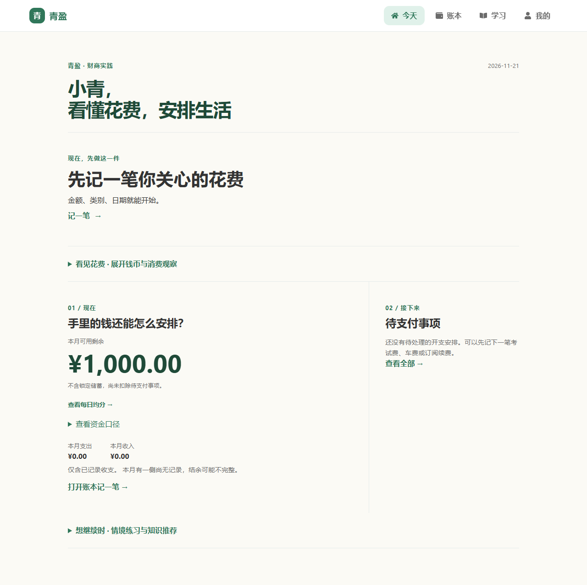
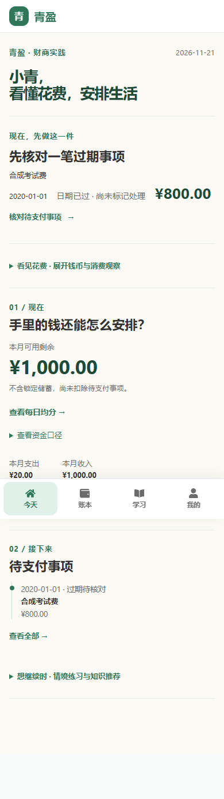

# v1.16 学生主路径改进

状态：已验收。此次为用户授权的专项批次，不重复计入 11 月 21 日两项例行任务。

## 问题与验收条件

| 问题 | 本次交付范围 | 验收条件 |
| --- | --- | --- |
| 首页内容并列，首次进入与回访缺少重点 | 一个主要行动：过期事项、七天内付款、资料核对、上次行动、消费观察 | 每种条件只有一个主要行动；读取失败不冒充无事项 |
| 过期事项被首页过滤，与资金规划不一致 | 按原日期展示未处理事项，优先过期事项，保留全部数量和账本入口 | 已处理排除，原日期不改，超过三项仍有总数及查看入口 |
| 资金公式占据首屏 | 首页简短提示，完整口径可展开，账本原用法保留 | 零与负值保留，未知不当作零，计算公式不改 |
| 练习与推荐抢占首页 | 归入可展开区域，首次展开才请求练习及挂载推荐 | 展开后旧路径可用，不自动跳转、不自动发送 AI 消息 |
| 回访没有承接上次行动 | 直接引用本人已保存的下一步，返回原复盘入口 | 不编造行动，不把点击当作完成 |

## 保留的约束

首次学生问卷仍按用户要求为必答，不恢复已撤回的前置教学页。三端入口和后端权限不变。没有新增模型训练、提醒发送、自动付款或账务写入。

通过 REACT_APP_HOME_FOCUS=false 并重新构建可恢复原首页层次；过期事项展示的正确性修复仍保留。整批可撤销发布提交回退，无数据库迁移。

## 后续验证：九项批评的处理边界

| 批评 | 当前处理 | 需要继续取得的证据 |
| --- | --- | --- |
| 首页主次 | 本批收敛主要行动 | 首次任务完成与迷失位置 |
| 跨页矛盾 | 修复首页漏过期事项 | 真实低频回访走查 |
| 12 道自评成本 | 保留用户明确要求 | 填写耗时、退出原因及对后续推荐是否有用 |
| 财务理解负担 | 首页折叠公式、保留依据 | 用户是否能解释金额前提 |
| 钱币与行动 | 保留消费观察到教练/复盘路径，并可从主要行动展开 | 与纯数字对照是否提升理解和行动 |
| AI 必要性 | 不改现有模型效果表述 | 同样情境下规则、现有 AI 的正确性、追问次数与纠正成本 |
| 知识学习价值 | 推荐按需读取，现有算法保留 | 推荐是否解决当次问题及后续迁移表现 |
| 低频维护成本 | 待支付事项及上次行动优先 | 不完整资料下是否能继续任务 |
| 用户验证缺失 | 制定下面的试用流程 | 招募与实际观察，尚未完成 |

## 小规模试用流程（待真实参与者执行）

先招募 5—8 名自愿同学开展可用性观察，不将这一人数视为教育效果样本。使用模拟账单，不要求提供真实隐私数据。

1. 新用户：完成现有自评后，记一笔开支并解释当前资金是否已经扣除未来付款。
2. 回访：提供一笔过期未处理事项和已保存行动，让同学自行找到需要核对的事情；观察是否误认为已扣款。
3. 消费感知：比较数字展示与钱币展示，交替展示顺序，记录发现、解释与下一步；不预设钱币一定更好。
4. 学习与 AI：围绕同一问题，比较规则内容与现有 AI 的帮助、错误和额外输入；点击率单独记录，不当作学习效果。

记录任务完成、需要帮助、误解金额、停滞位置和口头反馈；先修最常见阻塞，再决定增加或删去功能。长期教育效果另设研究方案、授权和样本依据。

## 界面与验证记录

桌面以首次使用的记账行动为重点，其余内容保持可达。下图为手机过期待核对场景，日期与金额保留，主要入口直接前往待支付事项。

前端完整 43 套 297 项通过；截图复核后补充金额提示检查 1 项通过，共 298 项不同检查。相关财务后端 68 项通过，生产构建成功，主包 559.32 kB gzip（已有包体积提示仍在）。没有修改财务计算或推荐模型。

Edge 在 390px 和 1280px 下分别验证首次使用、过期事项、未知资金、上次行动、消费观察和读取失败共 12 个场景；检查首屏行动可达、键盘展开、延迟请求、钱币到推荐的展开及聚焦、处理后回首页不再提示、无横向溢出和页面异常。已查看手机与桌面截图。脚本为 scripts/test-home-focus.cjs，参数为 Playwright 模块和浏览器可执行路径，默认读取 build-verification。

所有接口为隔离模拟，未访问真实账号或远程 AI。浏览器验收针对发布构建，未包含原工作区未提交的月度回顾和必答问卷草稿；原有草稿在合并时保留。没有真实用户试用或效果结论。
