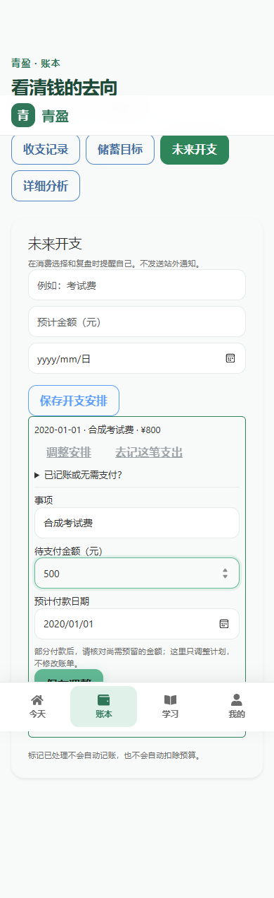

# v1.18 待付安排调整

状态：已验收；用户授权专项。

问题：待付金额或日期变化后，原界面不能修改；部分付款只能保留原金额，可能重复预留已支付部分。

验收：未处理事项可修改名称、待付金额与日期；取消或失败保留原安排及输入；账户隔离、精确金额、保存前版本检查、已处理事项保护；调整参与规划但不改交易。

金额表示仍需预留的待付金额。部分付款需先核对实际账单，再手动填写未付金额。本版不自动推算或关联账单。

保存前比较 updated_at 检出顺序发生的旧页面覆盖；沿用现有学习存储的读后写模式，并非跨进程原子 CAS。三种存储的强并发保护仍需单独改造，不将本次版本检查称为完整并发控制。

整批撤销发布提交可回退，无数据库迁移。

## 验证与使用

待付事项 → 调整安排 → 核对名称、尚需预留金额和日期 → 保存调整。取消不写入，失败保留输入。旧页面被拒绝时，可选择读取最新安排，明确提示这会替换当前草稿；已处理事项须先核对处理状态。

完整前端 43 套 309 项、相关后端 72 项通过，生产构建成功（主包 560.76 kB gzip，既有体积提示仍在）。后端验证金额、日期、名称、越权、处理状态、旧版本及调整后规划金额；不新增交易，不改变事项 ID 与创建时间。

Edge 在 390px、1280px 各验收保存、取消、冲突恢复共 6 个编辑场景，并回归付款链路 12 个场景。全量隔离接口，无真实用户数据；已查看截图，无横向溢出或页面异常。脚本 scripts/test-upcoming-edit.cjs 接受 Playwright 模块和浏览器可执行路径，默认读取 build-verification。

目前存储后端的强并发控制及真实试用仍待后续。本轮测试为本机开发存储与隔离浏览器，不代表 MySQL/Firestore 的实机并发验证或教育效果。
