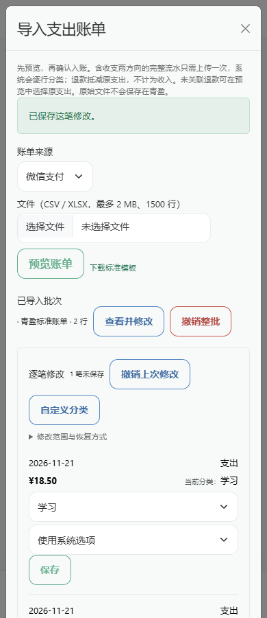
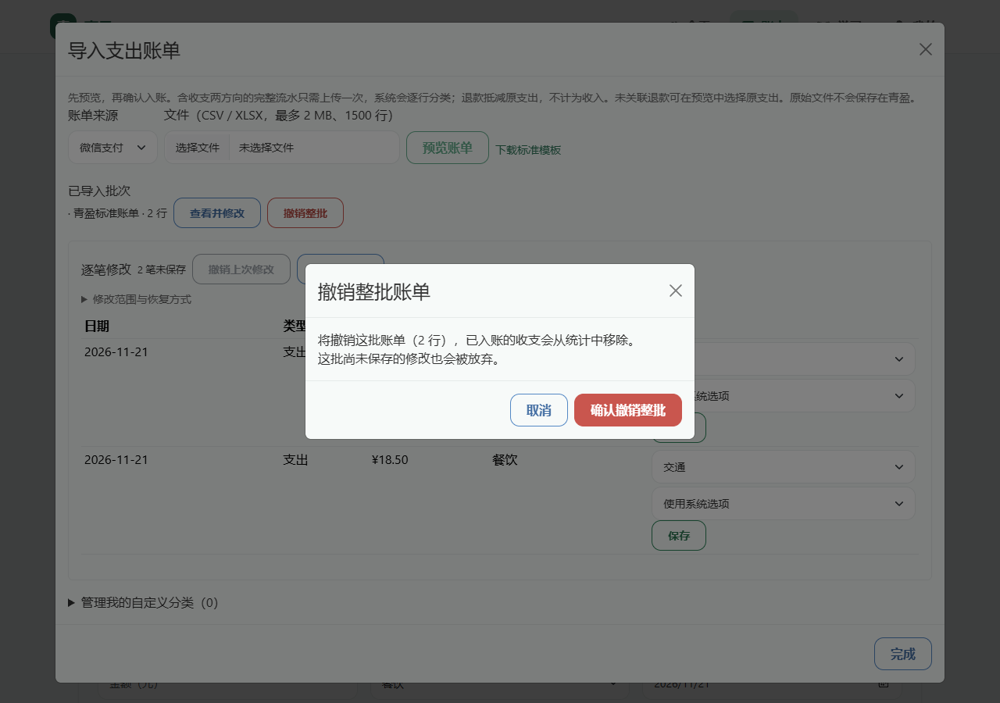

# v1.20 导入修改保护

## 开始时的证据与验收条件

本批是用户授权的主流程专项，基线为 v1.19，不重复计算当日自动任务。

| 问题 | 证据 | 预期行为与验收 |
| --- | --- | --- |
| 逐笔保存丢失其他草稿 | 手机 Edge 实际交互：改第2行为学习、第3行为交通，保存第2行后第3行恢复餐饮。saveRow 清空整个 rowDrafts。 | 成功仅清除本行草稿，其他行保留且可继续保存；失败保留所有草稿；只提交点击的行。 |
| 离开与撤销缺少保护 | 查看另一批次、重新打开当前批次和关闭会清空逐笔草稿；撤销整批按钮直接调用删除接口，没有确认，还无条件清空当前查看批次。 | 有草稿时离开/重新打开/撤销上次修改先确认；取消不丢输入、不提交。整批撤销总要确认，失败可原地重试；撤销别的批次不清空当前批次。 |

另发现刷新反馈链路不通：Dashboard.refreshLedger 捕获读取失败后正常返回，导入和补记弹窗的 onSaved 无法感知失败，已有“只刷新账本”入口不会出现。验收：模拟保存成功但概览读取失败，在弹窗内显示局部重试；恢复后只读数据，不重复保存，其他草稿保留。

## 实施与验证

- 逐笔保存仅清除已成功提交的那一行；其他分类、收款类型与退款关联草稿继续保留。失败不清空输入，显示未保存笔数。
- 关闭弹窗、切换或重开批次、撤销上次修改前检查草稿。确认放弃后才执行；读取另一批失败仍保留原批次和输入。预览中已修改的分类与关联也受关闭保护。
- 撤销整批先明确影响及行数；取消不发送请求，失败显示在确认弹窗内，原地重试。只在撤销当前批次成功时清理它的草稿，不影响其他批次。
- 账本刷新返回成功状态，导入与补记弹窗能识别读取失败。成功写入与刷新失败分开显示，“只刷新账本”不再次提交修改或补记。
- 手机将逐笔编辑表格转为连续纵向账单行，选择框完整展示；保留桌面表格。长操作说明按需展开，确认弹窗遮罩覆盖父弹窗。

| 验证 | 结果及范围 |
| --- | --- |
| 复现 | v1.19 生产包手机 Edge：保存第一行使第二行草稿由交通恢复餐饮。补充浏览器复现保存成功、读取失败后局部重试按钮不出现。 |
| 前端 | 完整43套、318项通过；手机样式改动后再次运行受影响的63项，全部通过。新增8项覆盖独立保存、关闭确认、读取失败、整批撤销和真实父子组件刷新反馈。 |
| 后端 | 账单导入、自定义分类、手动收支、删除相关55项通过。未修改后端代码；使用 Flask 测试客户端与隔离数据。 |
| 浏览器 | Edge，390和1280像素；新增10个导入场景、既有2个分类菜单场景、12个待付款记账场景通过。覆盖预览修改至确认入账、失败重试、取消离开、草稿保留。最终遮罩调整后重新验收2个撤销场景。 |
| 构建及文档 | 生产构建成功，主包561.45 kB gzip，原有体积提示仍在。README核对60个去重链接，差异检查通过。 |

浏览器使用真实页面交互和模拟接口；不代表真实后端端到端或真实用户试用。所有验证使用合成账单，未更改真实记录、三端权限、金额口径、AI模型和推荐算法。

## 界面核验

下图为实际程序与隔离模拟数据，已人工查看手机和桌面截图。手机选择框不再被表格挤窄，桌面整批撤销先显示影响，取消可返回输入。

## 限制、下一步与回退

- 草稿保护覆盖弹窗关闭和批次导航；浏览器整页刷新、关闭浏览器或主动换文件并不会持久保存草稿。后续再评估是否需要会话内恢复。
- 本轮没有引入跨页面编辑冲突控制；其他客户端修改同一批次时仍需另行设计版本校验。
- 本轮保持三端独立；没有把未提交的必答问卷、月度回顾、教练和导航草稿作为本次发布。
- 整批撤销发布提交可回退，无需迁移数据库；不要移动既有标签。提交和远端同步状态见 Git 历史及交付报告。
