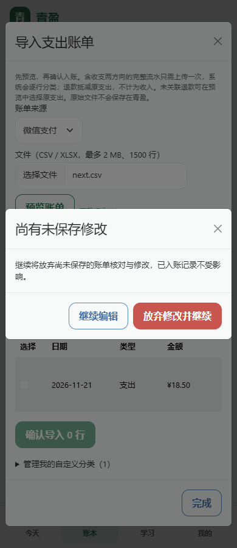

# v1.21 导入核对保护

## 开始前的问题与验收

| 当日任务 | 代码证据 | 验收条件 |
| --- | --- | --- |
| YG-027 核对结果保护 | v1.20 更换文件/来源直接 clearPreview，重新预览成功后直接清空分类；关闭检查遗漏只改勾选的情况。 | 分类和勾选发生变化时，重新预览、换来源、换文件、关闭先确认；取消保留文件、来源、分类和勾选的一致性；读取失败保留原核对结果。 |
| YG-028 多行勾选减负 | 预览最多1500行，但只有逐行勾选，清空或恢复选择需重复操作。 | 增加全选可导入/清空选择，复用逐行可选条件；不选重复行、未补齐条件的退款或收款，不自动入账；手机和桌面验证。 |

## 实现与验收

- 预览是否已改动同时比较分类/关联修改和初始勾选集合；只取消勾选也能得到保护，没有修改时不增加确认。
- 文件选择保留上次接受的 FileList。新文件待确认期间先恢复旧选择，取消后原文件名、文件对象和预览一致；确认后才接受新文件并清空预览。来源同样按确认后的值切换。
- 重新预览先确认，成功才替换原核对结果；请求失败时保留原分类和勾选。
- 全选与逐行复用同一个可选条件；重复、条件不足的退款/收款不会因批量操作被选中。清空只改变勾选，不清空分类和退款关联。

| 检查 | 结果 |
| --- | --- |
| 复现 | 修复前新增4个测试均失败，其中覆盖重新预览直接丢分类、换来源直接丢预览和只改勾选关闭不确认。 |
| 前端 | 完整43套、322项通过，包含新增4项。 |
| 后端 | 导入与自定义分类相关20项通过；未改服务端、财务口径或权限。 |
| 浏览器 | Edge手机390与桌面1280像素，各完成换文件/来源取消、失败恢复、勾选保护、批量选择至明确入账；另10个既有导入修改场景通过。共12个场景，均使用模拟接口与合成数据。 |
| 构建 | 生产构建成功，主包561.6 kB gzip，既有体积提示仍在。 |

实际截图已查看，以下为模拟数据下取消勾选后的关闭保护：

## 限制、下一步与回退

草稿仍仅在打开的页面内保留，不提供浏览器整页刷新后的持久恢复。全选沿用现有人工核对条件，最终仍由后端复核，不宣称替代用户判断或验证财商教育效果。下一步可在隔离环境继续检查退款关联后的筛选效率。

测试未操作真实账单、模型或外部消息；保留本地问卷、月度回顾等未提交工作。撤销本批发布提交即可回退，无数据迁移；不移动旧标签。提交与同步状态以 Git 历史和交付记录为准。
