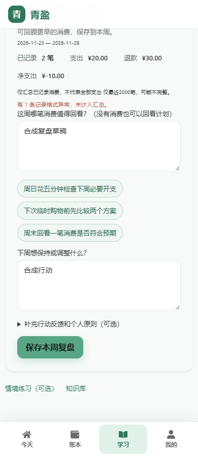

# v1.22 每周账目汇总

## 开始前证据和验收条件

| 任务 | 证据 | 验收条件 |
| --- | --- | --- |
| YG-029 汇总可靠性 | weekly_facts直接float读取amount，缺金额/非法数字会使整块接口失败，NaN可进入响应；直接截日期未验证日历。 | 历史异常行不使有效数据不可读；跳过数量明确告知，不当成完整汇总；按分精确计算，未来及周外记录排除。 |
| YG-030 复盘口径可见 | 每周复盘只有“合计”，无法分辨消费减少还是退款到账。 | 支出、退款、净支出并列展示，保留笔数和不完整提示；退款大于支出时显示负净额。桌面和手机验证，不添加操作门槛。 |

## 验收结果

- 修复前8项新增回归失败：缺金额和非数字会返回503；布尔、负数、超限金额未被可靠排除；缺少拆分和完整性字段。修复后相关48项后端测试通过，含8项新增回归。
- 每周汇总复用资金服务的十进制转分规则，每条历史金额先四舍五入到分，整数累加。非法、非有限、布尔、负数、超限、舍入为零的金额及无法解析的日期不参与统计，返回 skipped 数量。只统计周一到北京时间当天已发生的支出与退款，收入和区间外记录不计入。
- 新增 gross_expense、refunds、skipped、complete；保留 start、end、count、total、limited 等既有字段。complete只有未截断且没有跳过记录时为真，仍不代表用户记录了全部消费。
- 前端相关9项通过，含新增1项。支出、退款、净支出并列展示，兼容旧接口缺少拆分字段的情况；跳过和2000笔读取限制均明确提示。
- Edge在390与1280像素下共6个模拟接口场景通过：负净额、部分汇总、加载失败后重试，均继续填写并保存复盘。已查看截图；不等同于真实后端端到端或用户研究。
- 生产构建成功，主包561.7 kB gzip，既有体积提示仍在。README与差异检查作为提交前门槛。

## 限制、后续与回退

仅在读取时处理历史异常，不改写历史账单；周汇总的旧高精度金额按分规范化，其他历史报表没有批量重算。跳过数量包括读取范围内无法确定日期的异常记录，不能直接当成本周异常笔数。原有2000笔读取上限保持，后续可评估完整分页汇总；本轮不扩大数据读取范围。

仅更改汇总与表达，不改变退款关联、资金预留、三端权限或模型。用户未提交的问卷、教练和月度回顾等工作保留。撤销本批发布提交可回退，无数据库迁移，不移动旧标签。提交及同步以Git历史和交付报告为准。
