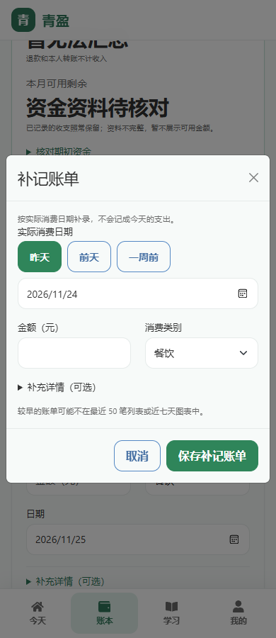

# v1.23 补做与录入减负

实际执行日期：2026-11-25。用户要求合并处理11月24日漏下及25日任务；四项统一验收交付，不追记为24日已完成。

| 任务 | 开始时证据 | 验收条件 |
| --- | --- | --- |
| YG-031 导入输入校验（补24日） | 文件选择仅设置accept，没有空文件/2MB/扩展名校验，选错后仍上传，替换还会先丢原预览。 | 无效文件不请求预览，不替换原文件和核对结果；有效文件仍按原保护流程接受，服务端仍最终校验。 |
| YG-032 分类加载恢复（补24日） | 分类只在挂载时请求一次，失败只显示通用错误，没有原地重读入口。 | 明确分类列表失败，重试只读分类，不重传文件、不重建预览、不清空勾选。 |
| YG-033 补记草稿保护（25日） | 取消、X、Esc和遮罩关闭直接丢输入。 | 有实际金额/详情草稿时确认再关闭；取消关闭保留所有输入；保存后空白新一笔无需确认。 |
| YG-034 补记输入减负（25日） | 可选商户、内容、备注全部常驻，手机表单长；内容缺少与服务端1000字上限对应的限制。 | 可选详情默认收起，可展开填写，收起不丢值；手机和桌面能保存完整内容。 |

## 实施与验收

四项均已验收。无效文件立即提示并恢复原选择，不调用预览接口、不触发丢弃原核对结果；分类读取使用独立错误面板和重试，不重传文件。补记关闭保护覆盖取消及统一关闭入口，选择继续填写保留金额与详情；保存时关闭确认提示并锁定关闭动作。仅日期/类别选择视为连续补记偏好，不单独触发草稿确认。详情收起不卸载输入，明确保存后才入账。

| 检查 | 结果与边界 |
| --- | --- |
| 先复现 | 新增6项回归在旧版失败：三类无效文件、分类无重试、补记直接关闭、详情无折叠/字数限制。 |
| 前端 | 完整43套、329项通过，含新增6项。 |
| 后端 | 导入、分类、手动收支、删除相关55项通过；未改服务端。 |
| 浏览器 | Edge手机390与桌面1280像素：新6个综合场景通过，覆盖文件拦截、分类重试、Esc/X关闭保护、折叠详情保留及保存；另2个核对保护与10个逐笔修改场景通过，共18个。 |
| 构建 | 生产构建通过，主包562.15 kB gzip，既有体积提示仍在。README链接与差异检查作为提交前门槛。 |

浏览器使用模拟接口与合成文件；不是全站真实后端端到端或用户教育效果验证。真实账单未改动，未提交的问卷、月度回顾等工作保留。

## 界面核验

已查看桌面和手机截图。手机补记以日期、金额和类别为主，可选详情按需展开；文件失败时原预览和勾选不变。

## 限制、下一步与回退

文件检查仅核对扩展名、空文件与2MB限制，内容、行数及账务规则仍由后端最终验证。分类恢复只刷新当前目录，历史分类快照和账目不重写。补记草稿不跨浏览器整页刷新持久化；本轮没有新增后台上传或提醒。后续可继续检查低频回访时的历史补记发现路径。

撤销本批发布提交可整体回退，无数据库迁移，不移动旧标签。版本按同一批四项联合交付递增一次；同步状态以Git历史和交付报告为准。
