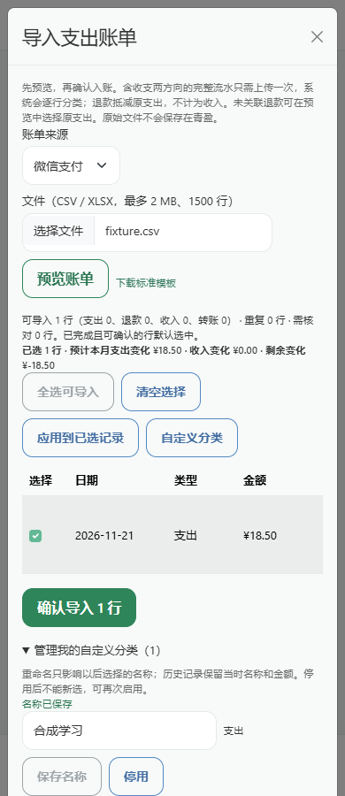

# v1.24 分类保存可靠性

## 开始时证据与验收

| 任务 | 证据 | 验收条件 |
| --- | --- | --- |
| YG-035 目录请求顺序 | refreshCategories有请求编号，但新增/删除/更新没有使旧读取失效，晚到的初始目录可能覆盖刚保存的分类。 | 保存结果优先于此前目录请求；新增、重命名和删除后旧响应不能回滚当前分类。用延迟响应先复现再验证。 |
| YG-036 重命名反馈与键盘 | names草稿保存成功后不清理，服务端去空格后的名称不会反映在输入框，保存按钮仍可能启用；输入不在表单内，回车无法保存。 | 成功采用服务端返回名称并停止重复保存；回车与按钮使用同一提交路径，失败保留草稿，停用不丢尚未提交的名称。手机和桌面核验。 |

## 实施与验收

- 分类变更成功后递增目录请求编号，使此前的挂载或重试读取失效，保存结果优先。新增保留接口返回的新分类，再刷新共享目录；删除只清理尚未提交的引用。完整目录刷新成功会清除读取错误。
- 每个分类使用独立表单，回车和保存按钮进入同一提交路径。提交前去掉名称首尾空格，成功移除该项名称草稿，输入框显示服务端返回值。重复提交锁防止同时发送保存请求。
- 管理区域显示简短成功提示和本地错误，重试时清除旧错误。失败保留名称输入；启停操作不会清空尚未提交的重命名草稿。历史账单分类快照不重写。

| 验证 | 结果与范围 |
| --- | --- |
| 复现 | 新增4项回归，其中2项先复现旧目录覆盖新分类，以及规范名称未反映到输入框；其余验证失败保留和启停不丢名称。 |
| 前端 | 完整44套、333项通过，含新增4项；相关40项亦通过。 |
| 后端 | 分类与导入相关20项通过；未改后端、账务口径或权限。 |
| 浏览器 | Edge手机390与桌面1280像素共4个新场景：延迟旧目录、新增后选择、回车失败重试、规范名称与禁用重复保存、停用保留草稿；原分类菜单2个场景通过。全程模拟接口与合成数据。 |
| 构建 | 生产构建通过，主包562.28 kB gzip，既有体积提示仍在。README及差异检查作为提交前门槛。 |

已查看手机与桌面截图。下图为实际页面与合成分类：

## 限制、下一步与回退

本轮处理当前页面内旧请求的顺序，不等于跨客户端或数据库级并发版本控制。页面整体刷新后的未提交重命名仍不持久化。浏览器验证不代表真实后端端到端、真实用户研究或AI效果。后续可继续检查多分类同时编辑的草稿恢复需求。

原有问卷、月度回顾等用户草稿保留；不修改真实账单、三端入口或模型。撤销本批发布提交可回退，无数据库迁移，不移动旧标签。提交和同步状态见Git历史与交付报告。
