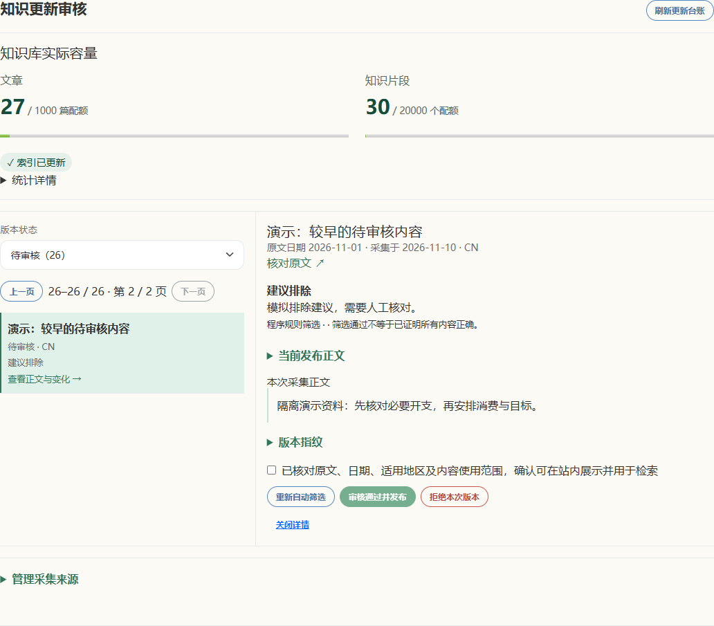

# v1.5 · 知识审核完整台账

2026年11月10日，两项日常任务：YG-005完整台账筛选分页、YG-006审核浏览与失败恢复。

## 问题与改动

旧接口只返回最近300个版本，浏览器再筛选，可能显示“没有待审核”而完整台账仍有旧记录。新接口先在完整台账按状态筛选，再取一页。页面每页25条；待审核包含排除建议，也可单独筛选排除建议。原文核对、明确确认、审核权限和版本冲突保护保持。

| 场景 | 现在的行为 |
| --- | --- |
| 较早待审核被新版本挤出 | 可通过状态队列和分页到达 |
| 翻页、切换状态 | 显示准确范围与总数，切换状态回第一页 |
| 正在读取 | 显示加载状态，不展示旧队列或空队列结论 |
| 读取失败 | 给出重试按钮，保留筛选与页码 |
| 审核后最后一页变空 | 服务端返回有效末页，导航按实际返回页显示 |
| 键盘操作 | 翻页后焦点回到分页导航，选中内容后焦点进入标题 |

手机验证还修正了未聚焦跳转链接的裁剪隐藏，聚焦时仍可见、可跳至主要内容。

图1：程序实际界面，隔离模拟26条待审核资料；第二页可查看较早资料，不代表真实知识库存。手机截图与请求清单由验收脚本写入本机tmp目录。

## 接口

`GET /api/admin/knowledge-updates?status=pending&page=1&page_size=25`

- `status`支持all、pending、approved、rejected、excluded；excluded按最新筛选结论选择。
- 未指定时沿用all及每页300条，兼容旧调用；新界面明确请求25条。
- `page`是正整数，`page_size`范围1–300；未知状态与非法参数返回400。
- 响应`pagination`包含page、page_size、total、pages；空列表是第1/1页、total=0，超出末页自动回到有效末页。
- 总状态计数与页内条数分开；按入库顺序倒序，最新筛选记录参与筛选，联表读取正文与原发布版本。新增状态与筛选历史查询索引。

## 验证及限制

全量前端42套286项通过；知识更新、自动化与知识接口相关后端37项通过。新增9项后端检查覆盖305条版本、旧待审核、最新筛选、越界页、空列表、参数及权限；前端新增4项覆盖筛选分页、读取失败、排除建议、读取期间与审核后页数收缩。

生产构建成功，主包557.46kB gzip，既有体积提示仍在。浏览器390px和1280px完成同一条验收路径，无页面异常、无横向溢出。复现使用`scripts/test-knowledge-review-delivery.cjs`，参数依次为Playwright模块与Edge可执行文件；`YG_CAPTURE_BUILD`可指定构建目录，`YG_CAPTURE_OUT`可指定截图目录。所有接口模拟，不访问真实账户、外部资料或远程AI，发布操作只作用于内存样例。

分页不是固定快照；并发新增记录时，重新读取的页内容可能移动。本轮未新增全文搜索，不声明大规模压测或真实用户效果。基础容量汇总仍复用原逻辑，不宣称整页查询已达到特定性能指标。

## 回退

撤销本轮发布提交即可恢复旧接口与页面，无内容数据迁移；新增SQLite索引可保留，不影响旧版读取。正常发布标签不移动；已发布正文、真实账单及私人申报材料没有被本轮修改。后续如需验证大量并发更新，应另建隔离数据集并测量。
